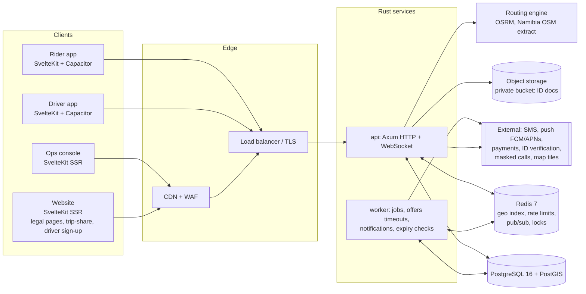

# FUber — Technical Requirements Document (TRD)

| | |
| --- | --- |
| Version | 1.0 (draft for sign-off) |
| Date | 2026-10-26 |
| Implements | [PRD v1.0](01-product-requirements.md) |
| Stack | Rust (backend) · Svelte 5 / SvelteKit 2 (all front ends) · PostgreSQL + PostGIS · Redis |

---

## 1. Architecture overview



- **Modular monolith** in Rust: one `api` binary and one `worker` binary from the same Cargo workspace. Split into services only when a measured need appears.
- The API is **stateless** apart from WebSocket connections; WebSocket fan-out across instances goes through Redis pub/sub so we can run ≥ 2 instances from day one.
- **The server is authoritative** for all ride state, prices, PINs and matching — as `demo/server.js` already is. Clients only send intents (`request_ride`, `accept_offer`, `verify_pin`…).

## 2. Technology choices

### 2.1 Backend (Rust, stable toolchain, edition 2024)

| Concern | Choice | Why |
| --- | --- | --- |
| HTTP / WebSocket | `axum` + `tokio` + `tower` / `tower-http` | De-facto standard; middleware for limits, timeouts, CORS, tracing. |
| Database | `sqlx` (Postgres, compile-time checked queries, migrations) | No ORM magic; SQL is reviewed; injection-safe by construction. |
| Geo | PostGIS `geography(Point,4326)`; Redis `GEOADD/GEOSEARCH` for live driver positions | Live positions change every few seconds — keep them out of Postgres. |
| Routing / ETA | Self-hosted **OSRM** (Namibia extract from Geofabrik), called over HTTP | Same OSM data as the demo; no per-request fees; respects one-way streets. |
| Validation | `serde` (`deny_unknown_fields`) + `validator` + domain newtypes | See §7.2. |
| Auth tokens | `jsonwebtoken` (EdDSA/Ed25519), opaque rotating refresh tokens | §7.4. |
| Password-like secrets | `argon2` (refresh-token & OTP hashing uses SHA-256 + server pepper; admin TOTP via `totp-rs`) | |
| Rate limiting | Redis-backed sliding window (custom `tower` layer) + `tower_governor` as in-process fallback | §7.1. |
| API docs | `utoipa` → OpenAPI 3.1 → generated TypeScript client for Svelte apps | One source of truth for request/response types. |
| Jobs | `worker` binary: Postgres-backed queue (`SELECT … FOR UPDATE SKIP LOCKED`) + Redis timers for 15 s offer expiry | No extra broker in v1. |
| Observability | `tracing` + OpenTelemetry (OTLP) → Grafana stack (or vendor); Sentry for panics | |
| Config / secrets | `figment` or env vars, loaded from the cloud secret manager at start | §7.3. |
| Testing | `cargo nextest`, `sqlx::test` (real Postgres per test), `insta` snapshots, `proptest` for pricing/matching | |

### 2.2 Front end (Svelte)

| App | Framework | Delivery |
| --- | --- | --- |
| Rider | SvelteKit 2 + Svelte 5 (runes), `adapter-static` (SPA) | Wrapped with **Capacitor** for iOS + Android |
| Driver | Same as Rider | Capacitor; needs background location while online |
| Ops console | SvelteKit SSR (`adapter-node`) | Web, behind SSO-style login + 2FA |
| Website | SvelteKit SSR/prerendered | Legal pages, trip-share viewer, driver application landing |

**Why Capacitor (not Tauri mobile, not a PWA):** the driver app needs reliable background geolocation, push notifications, secure key storage (Keychain/Keystore) and store distribution. Capacitor's plugins for these are mature; Tauri 2 mobile was evaluated and is a reasonable future option because it is Rust-native, but its plugin ecosystem for background location is thinner. A PWA cannot track location in the background on iOS.

Shared packages:

- `packages/ui` — Svelte component library + design tokens (from the [design brief](04-ui-ux-design-brief.md)).
- `packages/api-client` — generated from OpenAPI; never hand-write request types.
- `packages/map` — MapLibre GL JS wrapper (vector tiles, fuzzy-pickup circle, route line, demand heat map).

Front-end rules:

- TypeScript `strict`. ESLint + `svelte-check` in CI.
- **No `{@html}`** anywhere except the legal pages, which render trusted Markdown at build time. Lint rule enforces this.
- Strict Content-Security-Policy on web apps (§7.5).
- Offline-tolerant: last known ride state cached; actions queue with clear "reconnecting" UI.

### 2.3 Infrastructure

| Item | Choice |
| --- | --- |
| Region | Cloud region in **South Africa** (e.g. AWS `af-south-1` Cape Town or Azure South Africa North) for latency to Namibia. Confirm data-residency position with counsel (PRD §10). |
| Compute | Containers (ECS Fargate / Azure Container Apps / Kubernetes later). ≥ 2 API instances across 2 AZs. |
| Database | Managed PostgreSQL 16 with PostGIS, Multi-AZ, PITR backups 14 days, encrypted at rest. |
| Redis | Managed Redis 7, TLS + AUTH. |
| Object storage | Private bucket for identity documents; SSE-KMS; no public access; access only via 5-minute pre-signed URLs issued to ops reviewers. |
| Map tiles | Commercial vector-tile plan (e.g. MapTiler, Stadia) — **not** `tile.openstreetmap.org` (its usage policy forbids production apps). Keep "© OpenStreetMap contributors" attribution. |
| CI/CD | GitHub Actions: build, test, lint, `cargo audit`, `cargo deny`, `npm audit`, gitleaks, container scan, migrations dry-run, deploy to staging on `main`, production on tag. |
| Environments | `local` (docker-compose), `staging` (prod-like, fake payments, test SMS), `production`. No production data outside production. |
| IaC | Terraform (or OpenTofu) for all cloud resources. |

## 3. Repository layout (monorepo)

```
fuber/
├── backend/                 Cargo workspace
│   ├── crates/
│   │   ├── api/             Axum app: routes, extractors, middleware, WS
│   │   ├── worker/          Background jobs binary
│   │   ├── domain/          Pure logic: pricing, matching score, state machine, priority points (no I/O)
│   │   ├── db/              sqlx queries + migrations/
│   │   ├── geo/             OSRM client, geofences, fuzzing of pickup points
│   │   ├── integrations/    SMS, push, payments, ID verification, masked calling (traits + impls + fakes)
│   │   └── common/          Error types, validation newtypes, config, telemetry
│   └── migrations/
├── apps/
│   ├── rider/  driver/  ops/  web/
├── packages/
│   ├── ui/  api-client/  map/  config/
├── infra/                   Terraform, docker-compose, OSRM build scripts
├── docs/                    This folder
└── demo/                    Frozen reference prototype
```

`domain` is pure Rust with no I/O so the pricing, matching and state-machine rules from `demo/public/js/engine.js` can be ported with property tests that compare results to the demo.

## 4. Core domain logic

### 4.1 Ride state machine

States (from the demo, plus terminal states): `REQUESTED → SEARCHING → DRIVER_ASSIGNED → DRIVER_EN_ROUTE → DRIVER_ARRIVED → PIN_VERIFIED → IN_TRIP → COMPLETED → RATED`, with `NO_DRIVERS`, `CANCELLED` and `BLOCKED` (5 wrong PINs; only the safety desk can close it). `SCHEDULED` precedes `SEARCHING` for scheduled rides. Full diagram in [App Flow §3](03-app-flow.md#3-ride-state-machine).

- Transitions are a single Rust `enum` + `fn transition(state, event) -> Result<State, DomainError>`; invalid transitions are impossible to persist.
- Each transition is written in one DB transaction with optimistic locking (`version` column) and appended to `ride_events`.
- After commit, the event is published to Redis channel `ride:{id}` and pushed to both parties' WebSockets.

### 4.2 Matching

1. `GEOSEARCH drivers:online:{tier} FROMLONLAT … BYRADIUS 3000 m` → candidate IDs.
2. Filter: not on a trip, documents valid, wheelchair flag, not excluded for this ride, not held by priority rules.
3. ETA via OSRM `table` service (one call for all candidates).
4. Score with the PRD D-2 formula (pure function in `domain`), apply priority-point adjustments (D-5).
5. Offer to the top driver; Redis key `offer:{ride_id}` with 15 s TTL + worker timer; on decline/expiry re-run from step 1 excluding previous drivers.
6. Accept uses a Redis lock + DB `UPDATE … WHERE state='SEARCHING' AND version=$n` so two drivers can never win the same ride, and one driver can never accept two rides.

### 4.3 Pricing

`fare = max(minimum, base + perKm × km + perMin × min × baseTraffic) × surge`, rounded to N$0.10, using OSRM route distance/duration. Stored as integer **cents** (`BIGINT`) — never floats. The quote is signed (HMAC) and valid for 5 minutes; `request_ride` must present a valid quote, so the price charged is exactly the one shown.

### 4.4 Location & privacy rules

- Driver app sends location every 4 s while online (2 s during a trip), over the WebSocket. Stored in Redis (live) and as a sampled trip track (every 10 s) in `ride_track_points` during trips only.
- **Fuzzy pickup**: before arrival the driver receives a point randomly offset 100–200 m from the pickup and a 250 m circle. The exact point is sent only when the driver is within 50 m (server-side check against her reported position).
- **Destination**: never included in any driver-facing payload before `PIN_VERIFIED`. Enforced in the serializer (separate DTOs per role and state), with a test per state.
- Riders' location is collected only while the app is in the foreground for booking and during an active ride.

## 5. Real-time protocol

- One WebSocket per signed-in app: `wss://api.fuber.app/v1/ws`, authenticated with the access token in the first message (not in the URL, so it is never logged).
- Messages are JSON `{ "type": "...", "id": "...", "data": {...} }`, versioned with the API.
- Server → client: `ride.updated`, `offer.created`, `offer.expired`, `driver.location`, `chat.message`, `safety.check`, `session.revoked`.
- Client → server: `location.update` (driver), `ping`. All ride actions go over HTTPS (idempotent, with `Idempotency-Key` header) so they are rate-limited, validated and logged like any other request.
- Heartbeat 20 s; client reconnects with exponential backoff and refetches `GET /v1/rides/active` on reconnect.

## 6. Performance & capacity

| Metric | Target |
| --- | --- |
| API p95 latency (non-routing) | < 150 ms |
| Quote (incl. OSRM) p95 | < 600 ms |
| Ride event to other party's screen | < 1 s p95 |
| Location update fan-out | < 1 s p95 |
| Capacity at launch | 500 concurrent online drivers, 50 ride requests/min, 10× headroom tested |
| Availability | 99.5 % monthly (pilot), 99.9 % target after launch |
| RPO / RTO | ≤ 5 min / ≤ 1 h |

## 7. Security requirements

Security is a launch gate: every item here is **must**. A checklist version lives in the Implementation Plan §6.

### 7.1 Rate limiting on all public endpoints

Every HTTP route and the WebSocket handshake pass through a Redis-backed sliding-window limiter (tower layer). Limits are keyed by **IP** for unauthenticated routes and by **user ID + IP** for authenticated ones; OTP routes also key by **phone number**. Exceeding a limit returns `429` with `Retry-After`; repeated violations are logged as security events.

| Endpoint group | Limit (per key) | Extra |
| --- | --- | --- |
| `POST /auth/otp/request` | 3 / 10 min per phone; 10 / hour per IP | Exponential cooldown; CAPTCHA (e.g. Turnstile/hCaptcha) after 3 per IP; SMS-pumping guard: only +264 numbers in v1 |
| `POST /auth/otp/verify` | 5 attempts per challenge; 20 / hour per IP | Challenge invalidated after 5 failures |
| `POST /auth/refresh` | 30 / hour per user | Reuse of a rotated token revokes the whole family |
| `POST /rides/quote` | 30 / min per user | |
| `POST /rides` (request) | 5 / min, 30 / hour per user | |
| `POST /rides/{id}/pin` | 5 attempts per ride | 5th failure blocks trip + safety alert (PRD T-3) |
| `POST /safety/sos` | Never rejected (logged instead) | Safety must not be throttled |
| Uploads | 20 / hour per user | |
| Public trip-share `GET /t/{token}` | 60 / min per IP | Token is 128-bit random |
| Driver application (website) | 5 / day per IP | CAPTCHA |
| WebSocket messages | 2 msg/s per connection (location), burst 10 | Disconnect on abuse |
| Ops console login | 5 / 15 min per account + IP | Lockout + alert |
| Global per-IP backstop | 300 / min | Plus WAF rate rules at the edge |

Rate-limit settings are config, not code, and are covered by integration tests.

### 7.2 Strict input validation and sanitisation

- **Parse, don't validate**: every request body deserialises into a typed struct with `#[serde(deny_unknown_fields)]`; fields use domain newtypes whose constructors validate (`PhoneE164`, `PersonName`, `Plate`, `LatLng`, `Cents`, `Pin4`, `Rating1to5`, `ShortText<500>`). Handlers never see raw strings.
- Rules (non-exhaustive):
  - Phone: E.164, `+264` only in v1.
  - Names: 1–80 chars after Unicode NFC normalisation + trim; letters, spaces, `-'.`; no control characters.
  - Coordinates: finite numbers inside the service area polygon (Windhoek + 20 km).
  - Enums (tier, payment method, cancel reason, document kind) — closed sets.
  - Free text (chat, reports, notes): ≤ 500 chars (chat) / 2000 (reports), control characters stripped, stored as plain text.
  - Passengers 1–4; rating 1–5; schedule time 30 min – 7 days ahead.
  - IDs are UUIDs; the public ride code `FU-xxxx` is display-only and never used for lookups without an ownership check.
- **Body size limits**: 16 KB JSON default; uploads 10 MB.
- **File uploads** (ID, licence, selfie): go direct to object storage via pre-signed POST with size and content-type conditions; the worker then verifies magic bytes (JPEG/PNG/HEIC/PDF only), re-encodes images (strips EXIF/GPS metadata and any embedded payload), virus-scans (ClamAV), and only then marks the document `uploaded`.
- **SQL**: only `sqlx` parameterised queries; no string-built SQL. CI greps for `format!` inside query calls.
- **Output encoding**: Svelte escapes by default; `{@html}` banned (§2.2). SMS and push texts are built from templates with user values inserted as plain text and length-capped.
- **Authorization on every object**: every query that loads a ride/document/chat filters by the caller's ID or role (no IDOR). Tested with a "wrong user" test for every endpoint.
- Errors return a stable error code + safe message; never stack traces, SQL, or internal IDs.

### 7.3 Secure API key and secret handling

- **No secrets in the apps.** Mobile and web bundles contain only public, restricted identifiers (map-tile key restricted by bundle ID / domain + quota, payment provider publishable key, FCM sender config). Everything else (SMS, payments secret, ID-vendor, OSRM, DB, JWT signing key) lives on the server only.
- Secrets are stored in the cloud **secret manager**, injected at runtime; never in Git, Docker images, Terraform state in plain text, or logs.
- `.env` files only for local development with fake/test credentials; `.env.example` committed, `.env` git-ignored (already in `.gitignore`).
- CI runs **gitleaks** on every push; a pre-commit hook does the same locally.
- Rotation: JWT signing keys rotated every 90 days with `kid` overlap; third-party keys every 180 days or immediately on staff departure/suspected leak. Runbook in `infra/runbooks/rotate-secrets.md`.
- Least privilege: API and worker run with separate cloud identities; the API cannot read the documents bucket except to issue pre-signed URLs; ops staff never hold production DB credentials (break-glass account with alert).
- Incoming webhooks (payments, SMS delivery, ID vendor) are verified by signature (HMAC) and timestamp (±5 min), and are idempotent.
- Existing repo hygiene: the demo's `docker-compose.yml` password and `demo/android/debug.keystore` are dev-only; production signing keys live in the CI secret store / Play App Signing, never in the repo.

### 7.4 Authentication, sessions and authorisation

- Phone + SMS OTP (6 digits, 5-minute expiry, hashed at rest).
- Access token: JWT (Ed25519), 15-minute lifetime, claims `sub`, `role`, `sid`, `kid`.
- Refresh token: 256-bit random, stored hashed, 30-day lifetime, **rotated on every use**, reuse detection revokes the session family.
- Mobile: tokens in iOS Keychain / Android Keystore (Capacitor secure-storage plugin), never in `localStorage`.
- Ops console: session cookie `HttpOnly; Secure; SameSite=Strict`, CSRF token on mutations, **mandatory TOTP or WebAuthn**, 8-hour session, IP allow-list optional.
- Role-based access control: `rider`, `driver`, `ops_reviewer`, `ops_safety`, `ops_support`, `ops_admin`. Enforced in an Axum extractor per route, plus row-level checks.
- Device binding: new device sign-in notifies the user; a driver can be signed in on one device at a time (as in the demo).

### 7.5 Transport and web hardening

- TLS 1.2+ only, HSTS (preload) on all domains; certificate pinning considered for mobile (with backup pins).
- Headers on web apps: CSP (`default-src 'self'`; script hashes; map-tile and API origins allow-listed), `X-Content-Type-Options: nosniff`, `Referrer-Policy: strict-origin-when-cross-origin`, `Permissions-Policy`, `frame-ancestors 'none'`.
- CORS: allow-list of FUber origins only; Capacitor origins (`capacitor://localhost`, `https://localhost`) explicitly listed.

### 7.6 Data protection

- Encryption at rest everywhere (DB, Redis, backups, bucket). Application-level envelope encryption (AES-256-GCM, KMS data keys) for **national ID numbers, dates of birth and emergency-contact phones**.
- Identity images are never sent to clients other than ops reviewers; the rider/driver profile photo is a separate, cropped image.
- Data retention jobs implement the [Privacy Policy](legal/privacy-policy.md) schedule (e.g. trip GPS tracks deleted after 90 days unless tied to an incident).
- Logs: no OTPs, tokens, PINs, full phone numbers (mask to `+264 81 *** **12`), or exact addresses. Structured logging with a redaction layer.
- Audit log (append-only) for every ops action and every access to identity documents.

### 7.7 Secure development

- Dependency scanning (`cargo audit`, `cargo deny`, `npm audit`, Dependabot/Renovate).
- `unsafe` Rust forbidden in our crates (`#![forbid(unsafe_code)]`).
- Threat model (STRIDE) for auth, dispatch, safety and payments before building each.
- External penetration test before the pilot; again before public launch.
- OWASP ASVS Level 2 as the verification baseline; OWASP MASVS for the mobile apps.

## 8. Integrations

| Integration | Purpose | Requirement |
| --- | --- | --- |
| SMS gateway | OTP, guest PIN, emergency alerts | Delivery to MTC and Paratus; delivery receipts; two providers with failover for safety messages |
| Push (FCM / APNs) | All in-app notifications | |
| Payments | Card tokenisation, pre-auth, capture, refunds, payouts | PCI DSS handled by provider (hosted fields / SDK); webhooks signed |
| ID verification (optional) | Document + liveness | Namibian ID support; data processing agreement; fallback to manual review |
| Masked calling | Rider ↔ driver calls | Numbers never exposed; call metadata only |
| OSRM | Routes, ETAs, distance matrix | Self-hosted, rebuilt monthly from OSM |
| Map tiles | Map display | Commercial plan; key restricted |

Every integration sits behind a Rust trait with a **fake** implementation used in local, CI and staging, so the system runs end-to-end without third-party accounts (as the demo does).

## 9. Observability & operations

- Metrics: request rate/latency/errors per route, match rate, offers per ride, time-to-assign, SOS latency, WebSocket connections, OSRM latency.
- Alerts (paged 24/7): API error rate > 2 %, SOS event not acknowledged in 60 s, SMS provider failure, DB CPU > 80 %, no drivers online in daytime.
- Tracing across API → worker → integrations with a ride ID attribute.
- Runbooks for: SOS pipeline failure, SMS outage, payment outage, DB failover, secret rotation, data-subject requests.

## 10. Testing strategy

| Level | What | Tooling |
| --- | --- | --- |
| Unit / property | Pricing, matching score, state machine, priority points, fuzzing radius | `proptest`, compared with demo engine outputs |
| Integration | Every endpoint incl. auth, validation failures, rate limits, wrong-user access | `sqlx::test`, `reqwest` |
| Contract | OpenAPI schema vs. generated client | CI diff |
| E2E | Full ride on two simulated phones (rider + driver), SOS, cancel, PIN failures | Playwright against web builds; Maestro/Appium on devices |
| Load | 500 drivers sending locations, 50 req/min | k6 |
| Security | Dependency scans, DAST (OWASP ZAP) on staging, pen test | |
| Accessibility | axe in CI, manual screen-reader pass | |
