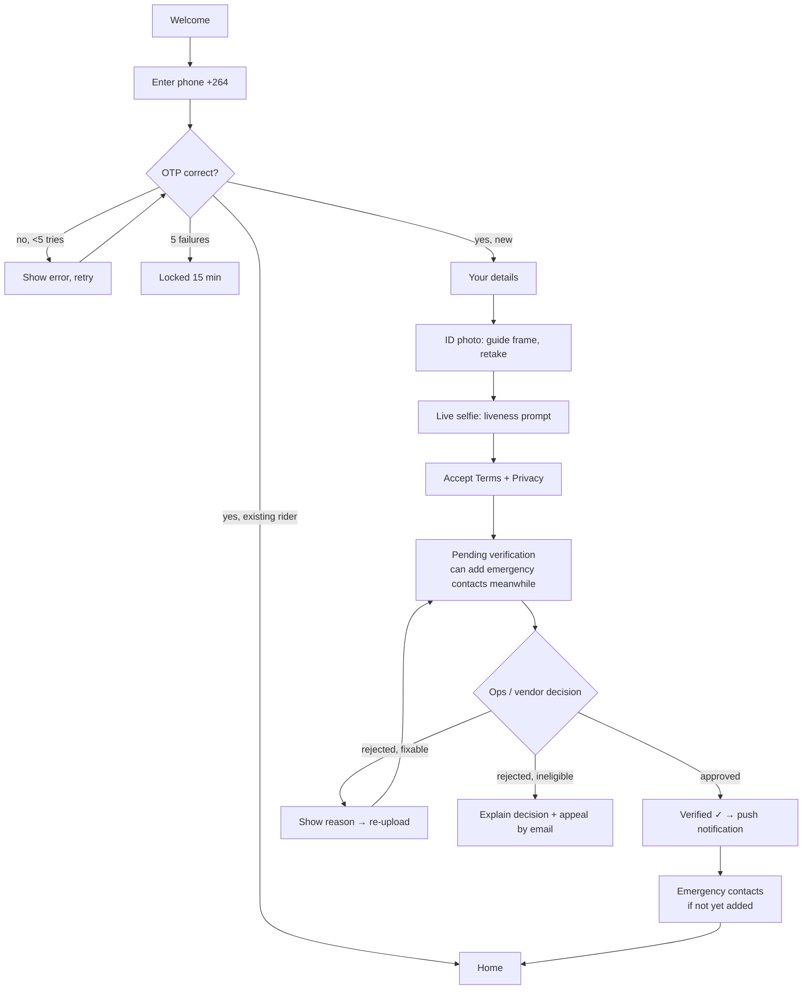
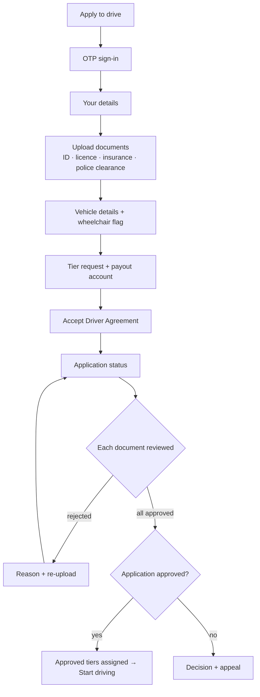
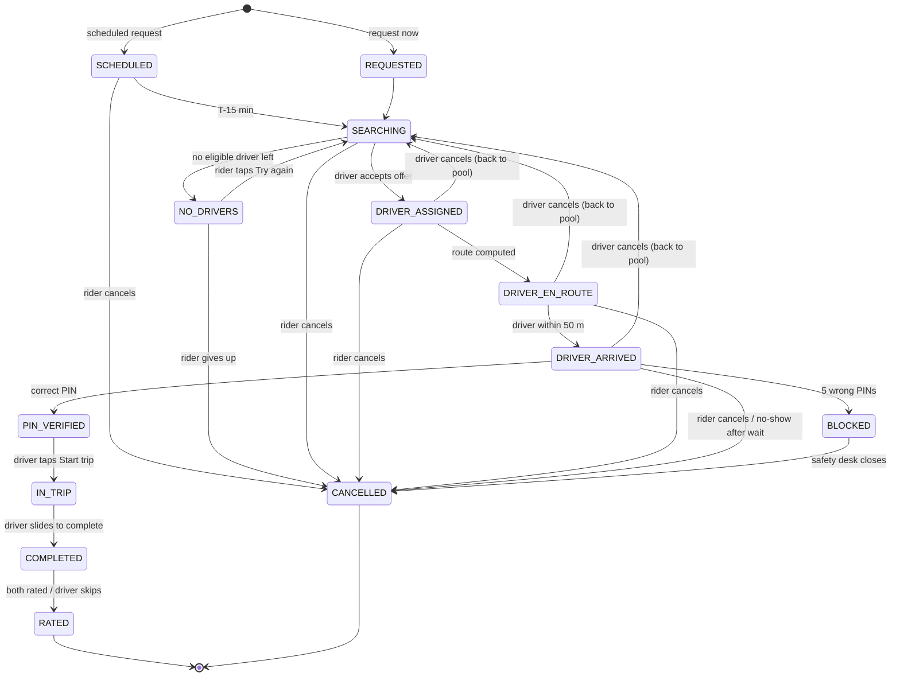
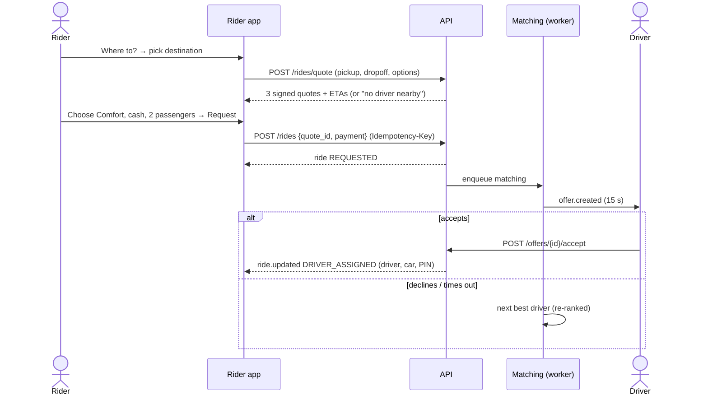
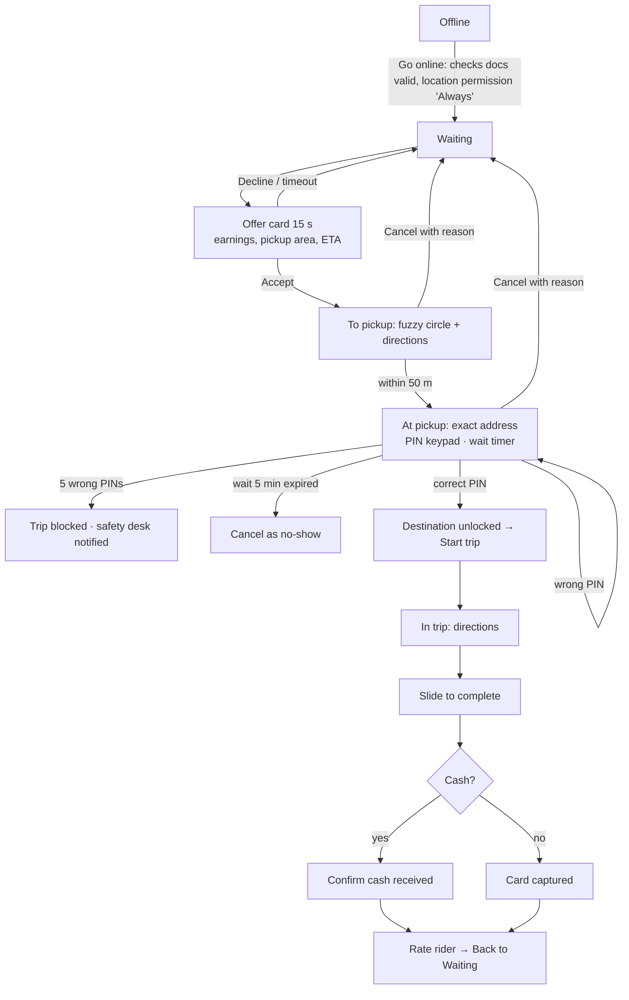
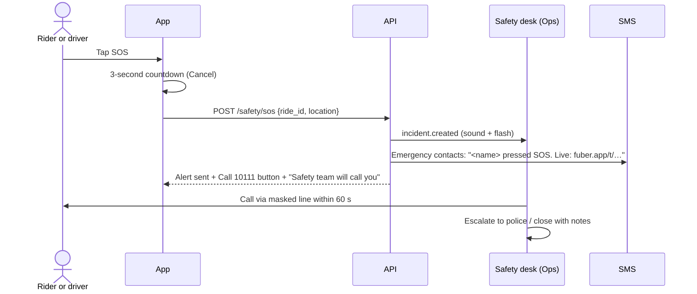

# FUber — App Flow

| | |
| --- | --- |
| Version | 1.0 |
| Date | 2026-10-26 |
| Related | [PRD](01-product-requirements.md) · [Design brief](04-ui-ux-design-brief.md) |

Diagrams are Mermaid (render on GitHub and in most Markdown viewers). Screen names in **bold** are the canonical names used in Figma and in code (`apps/*/src/routes`).

---

## 1. App map

### 1.1 Rider app

```
Launch
├── Welcome ── Sign in (phone → OTP)
│               └── New user → Onboarding
│                   ├── Your details (name, DOB, email optional)
│                   ├── Verify identity (ID photo → selfie) → Pending verification
│                   ├── Emergency contacts (1–3, can skip)
│                   └── Accept terms
└── Home (map)  [bottom tabs: Ride · Trips · Safety · Account]
    ├── Where to? → Search → Ride options → (Schedule) → Finding driver → Driver en route
    │                                      → Arrived (PIN) → In trip → Pay & rate
    ├── Trips: Upcoming · Past → Trip detail → Report issue
    ├── Safety: Emergency contacts · Favourite drivers · Safety tips · How SOS works
    └── Account: Profile · Payment methods · Saved places · Notifications · Legal · Delete account
SOS button: on every screen during a ride.
```

### 1.2 Driver app

```
Launch
├── Welcome ── Sign in (phone → OTP)
│               └── New applicant → Application
│                   ├── Your details
│                   ├── Documents: ID/gender verification · Licence · Insurance · Police clearance
│                   ├── Vehicle (make, model, colour, plate, year, seats, wheelchair)
│                   ├── Tier request · Bank details for payouts
│                   └── Submit → Application status (per-document status)
└── Home (map, Offline)  [bottom tabs: Drive · Earnings · Account]
    ├── Go online → Waiting (demand heat map) → Offer card (15 s)
    │      → To pickup (fuzzy circle) → At pickup (exact address, PIN keypad, wait timer)
    │      → Destination unlocked → In trip → Complete (slide) → Cash confirm → Rate rider
    ├── Earnings: Today · Week · Trips · Balance & payouts
    └── Account: Profile · Vehicle · Documents (expiry) · Payout details · Legal
SOS button: on every screen while online.
```

### 1.3 Ops console

```
Sign in (email + password + TOTP/WebAuthn)
├── Dashboard (live map, KPIs)
├── Verification: Riders queue · Driver documents queue · Applications
├── Safety: Live incidents · Incident detail · History
├── Trips: Search · Trip detail (timeline, map, chat log, payments)
├── Users: Search · Profile · Suspend/reinstate · Priority points
├── Pricing: Tiers · Surge zones · Matching parameters
└── Admin: Staff & roles · Audit log · Legal document versions
```

---

## 2. Onboarding flows

### 2.1 Rider sign-up and verification



Rules: a pending rider can browse the map and see prices but **Request** is disabled with *Available once you're verified*. Verification status is pushed live.

### 2.2 Driver application



Document expiry job: 30/7/1-day warnings; on expiry the driver is forced offline and sees *Upload new insurance to drive again*.

---

## 3. Ride state machine



What each party sees, per state:

| State | Rider sees | Driver sees | Data revealed to driver |
| --- | --- | --- | --- |
| SEARCHING | *Finding your driver…*, 3 km radius pulse, Cancel | Offer card (only the offered driver) | Pickup area (fuzzy), ETA, tier, passengers, rider first name + rating, earnings |
| DRIVER_ASSIGNED / EN_ROUTE | Driver card, car, plate, live car, ETAs, **PIN**, Share trip, Call/Message, Cancel | Turn-by-turn to fuzzy circle, Call/Message, Cancel | Same as above |
| DRIVER_ARRIVED | PIN card turns amber: *Show your driver this PIN* | Exact pickup address, PIN keypad, wait timer | **Exact pickup** |
| PIN_VERIFIED | *PIN confirmed — have a safe trip* | *Destination unlocked*, Start trip | **Destination** |
| IN_TRIP | Live route, ETA, Share trip, SOS | Turn-by-turn, Jump-to-complete when within 100 m | — |
| COMPLETED | Fare breakdown, payment, rate, add to favourites | Earnings, cash confirmation, rate rider | — |
| NO_DRIVERS | *No drivers accepted* → Try again / Change ride type | — | — |
| CANCELLED | Reason, *No fee charged* | Reason, back to Waiting | — |

---

## 4. Booking flow (rider)



Edge cases:

- **Quote expired** (> 5 min): request returns `409 quote_expired`; app silently re-quotes and asks the rider to confirm if the price changed.
- **Card pre-auth fails**: show *Card declined — choose another method*; ride not created.
- **App killed during search**: on relaunch `GET /rides/active` restores the screen.
- **Someone else**: after Request, the guest receives SMS: driver name, car, plate, PIN, live link. The driver sees *Guest · booked by Ndeshi (verified)*.
- **Scheduled**: after confirming, the ride appears in Trips → Upcoming; reminder push at T-30 min; dispatch at T-15 min.

## 5. Driver trip flow



## 6. Safety flows

### 6.1 SOS



- SOS works without an active ride (driver online, waiting).
- If the API call fails, the app retries and falls back to sending a pre-filled SMS from the user's phone to the safety desk number.

### 6.2 RideCheck

Trigger (server-side): > 150 m off planned route, or stopped > 2 min outside traffic signals/destination. → push + full-screen *Are you okay?* on rider app → *Yes, I'm fine* closes it; *Call for help* = SOS; no answer in 60 s → incident for safety desk.

### 6.3 Share trip

Rider (or driver) taps **Share trip** → token created → native share sheet / *Send to my emergency contacts*. The web page `fuber.app/t/<token>` shows live map, first name, car, plate, destination area, ETA, and *Call 10111*. Expires 30 min after the trip ends.

## 7. Cancellation & no-show

| Who / when | Result | Priority points |
| --- | --- | --- |
| Rider, before assignment | CANCELLED, no fee | No cost |
| Rider, after assignment | CANCELLED, no fee; driver notified | −5 × nth cancellation |
| Driver, after accepting | Back to SEARCHING, she is excluded | −5 × nth cancellation |
| Driver, no-show after 5-min wait | CANCELLED | Counts against the **rider** |
| Completed trip | — | +2 each (max 150) |

Points are never shown in the apps; only ops sees them.

## 8. Payment & rating

1. COMPLETED → rider sees fare breakdown (base, distance, time, surge, total) — same as the quote.
2. Card: captured automatically; cash: driver confirms *Cash received* (dispute button for rider if wrongly marked).
3. Rider rates 1–5 (reason required for < 3), optional *Add to favourites*.
4. Driver rates rider (or skips via *Back to requests*).
5. State → RATED when both rated or driver skipped.

## 9. Ops flows

- **Verification review**: queue sorted oldest-first → open item (ID image + selfie side by side, extracted data, previous attempts) → Approve / Reject with reason template → user notified. Every view of an identity image is audit-logged.
- **Incident**: new incident alarm → agent claims it → sees live map, trip timeline, chat → calls parties → actions (escalate to police, suspend user, notes) → close with outcome.
- **Suspension**: user immediately signed out (`session.revoked`), active ride handed to safety desk.

## 10. Notifications matrix

| Event | Rider | Driver | Guest (SMS) | Emergency contacts (SMS) |
| --- | --- | --- | --- | --- |
| Driver assigned | Push (+SMS fallback) | — | ✓ | — |
| Driver arriving (2 min) / arrived | Push | — | ✓ | — |
| Trip started / completed | Push | — | — | — |
| SOS | — | — | — | ✓ |
| RideCheck | Push + full screen | — | — | — |
| Verification decided | Push | Push | — | — |
| Document expiring | — | Push + SMS | — | — |
| Scheduled reminder | Push | — | — | — |
