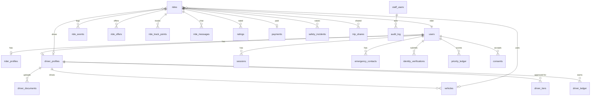

# VARA — Backend Schema

| | |
| --- | --- |
| Version | 1.0 |
| Date | 2026-10-26 |
| Database | PostgreSQL 16 + PostGIS 3.4 · Redis 7 |
| Related | [TRD](02-technical-requirements.md) §4, §7 |

This is the target schema for the first migration set (`backend/migrations/`). Conventions:

- Primary keys `uuid` (`gen_random_uuid()`); human-facing codes (`FU-4821`) are separate columns.
- All timestamps `timestamptz`, stored UTC; displayed in `Africa/Windhoek`.
- **Money is `bigint` cents** of NAD (`fare_cents`). Never `float`/`numeric` in app code.
- Locations `geography(Point, 4326)`.
- Columns marked 🔒 are encrypted at application level (AES-256-GCM envelope; stored as `bytea`). They cannot be queried by value; use the matching `*_hash` column (HMAC-SHA256 with a server key) where lookup is needed.
- Soft-delete only where retention requires; everything else is deleted by retention jobs.
- Every table has `created_at`; mutable tables have `updated_at` (trigger) and, where concurrent writes happen, `version int` for optimistic locking.

---

## 1. Entity overview



## 2. Types

```sql
CREATE EXTENSION IF NOT EXISTS postgis;
CREATE EXTENSION IF NOT EXISTS citext;

CREATE TYPE user_status        AS ENUM ('pending', 'active', 'suspended', 'deleted');
CREATE TYPE verification_status AS ENUM ('not_started', 'pending', 'approved', 'rejected');
CREATE TYPE document_kind      AS ENUM ('identity', 'selfie', 'licence', 'insurance', 'police_clearance', 'transport_permit');
CREATE TYPE document_status    AS ENUM ('uploading', 'in_review', 'approved', 'rejected', 'expired');
CREATE TYPE ride_tier          AS ENUM ('classic', 'comfort', 'softlife');
CREATE TYPE ride_state AS ENUM (
  'SCHEDULED', 'REQUESTED', 'SEARCHING', 'NO_DRIVERS', 'DRIVER_ASSIGNED', 'DRIVER_EN_ROUTE',
  'DRIVER_ARRIVED', 'PIN_VERIFIED', 'IN_TRIP', 'COMPLETED', 'RATED', 'CANCELLED', 'BLOCKED');
CREATE TYPE party              AS ENUM ('rider', 'driver', 'system', 'staff');
CREATE TYPE offer_response     AS ENUM ('pending', 'accepted', 'declined', 'expired', 'withdrawn');
CREATE TYPE payment_method     AS ENUM ('cash', 'card');
CREATE TYPE payment_status     AS ENUM ('pending', 'authorised', 'captured', 'cash_confirmed', 'voided', 'refunded', 'partially_refunded', 'failed');
CREATE TYPE incident_kind      AS ENUM ('sos', 'ridecheck_deviation', 'ridecheck_stop', 'pin_lockout', 'report');
CREATE TYPE incident_status    AS ENUM ('open', 'claimed', 'escalated', 'closed');
CREATE TYPE staff_role         AS ENUM ('ops_reviewer', 'ops_safety', 'ops_support', 'ops_admin');
CREATE TYPE ledger_kind        AS ENUM ('trip_earning', 'service_fee', 'cash_collected', 'payout', 'adjustment', 'refund');
```

## 3. Identity & accounts

```sql
CREATE TABLE users (
  id               uuid PRIMARY KEY DEFAULT gen_random_uuid(),
  phone_e164       text NOT NULL UNIQUE CHECK (phone_e164 ~ '^\+264[1-9][0-9]{7,8}$'),
  full_name        text NOT NULL CHECK (char_length(full_name) BETWEEN 1 AND 80),
  display_name     text NOT NULL CHECK (char_length(display_name) BETWEEN 1 AND 40), -- first name shown to the other party
  email            citext UNIQUE,
  date_of_birth    bytea,                -- 🔒
  national_id      bytea,                -- 🔒
  national_id_hash bytea UNIQUE,         -- HMAC, blocks duplicate accounts
  photo_key        text,                 -- object-storage key of the cropped profile photo (not the ID selfie)
  status           user_status NOT NULL DEFAULT 'pending',
  verification     verification_status NOT NULL DEFAULT 'not_started',
  verified_at      timestamptz,
  suspended_reason text,
  deleted_at       timestamptz,
  created_at       timestamptz NOT NULL DEFAULT now(),
  updated_at       timestamptz NOT NULL DEFAULT now()
);

CREATE TABLE rider_profiles (
  user_id          uuid PRIMARY KEY REFERENCES users(id) ON DELETE CASCADE,
  rating_avg       numeric(3,2),
  rating_count     int NOT NULL DEFAULT 0,
  priority_points  int NOT NULL DEFAULT 100 CHECK (priority_points BETWEEN 0 AND 150),
  cancel_count     int NOT NULL DEFAULT 0,
  created_at       timestamptz NOT NULL DEFAULT now()
);

CREATE TABLE driver_profiles (
  user_id               uuid PRIMARY KEY REFERENCES users(id) ON DELETE RESTRICT,
  application_status    verification_status NOT NULL DEFAULT 'not_started',
  approved_at           timestamptz,
  rating_avg            numeric(3,2),
  rating_count          int NOT NULL DEFAULT 0,
  acceptance_rate       numeric(4,3) NOT NULL DEFAULT 0.8,  -- rolling 30-day, feeds matching
  priority_points       int NOT NULL DEFAULT 100 CHECK (priority_points BETWEEN 0 AND 150),
  cancel_count          int NOT NULL DEFAULT 0,
  active_vehicle_id     uuid,              -- FK added after vehicles
  can_go_online         boolean NOT NULL DEFAULT false,  -- maintained by document-expiry job
  payout_account        bytea,             -- 🔒 bank details
  map_expert_until      timestamptz,       -- flat 15 % fee on every tier until then (0015)
  last_fix              geography(Point, 4326),  -- last believable position; kept when she goes offline (0018)
  last_fix_at           timestamptz,       -- a new position further than 100 m + 150 km/h since then is ignored
  created_at            timestamptz NOT NULL DEFAULT now(),
  updated_at            timestamptz NOT NULL DEFAULT now()
);

CREATE TABLE staff_users (
  id             uuid PRIMARY KEY DEFAULT gen_random_uuid(),
  email          citext NOT NULL UNIQUE,
  full_name      text NOT NULL,
  password_hash  text NOT NULL,           -- argon2id
  totp_secret    bytea,                   -- 🔒
  roles          staff_role[] NOT NULL,
  disabled_at    timestamptz,
  last_login_at  timestamptz,
  created_at     timestamptz NOT NULL DEFAULT now()
);

CREATE TABLE otp_challenges (
  id            uuid PRIMARY KEY DEFAULT gen_random_uuid(),
  phone_hash    bytea NOT NULL,           -- HMAC of phone, so OTP table never holds numbers
  code_hash     bytea NOT NULL,           -- SHA-256(code || pepper)
  attempts      smallint NOT NULL DEFAULT 0,
  expires_at    timestamptz NOT NULL,
  consumed_at   timestamptz,
  ip            inet,
  created_at    timestamptz NOT NULL DEFAULT now()
);
CREATE INDEX ON otp_challenges (phone_hash, created_at DESC);

CREATE TABLE sessions (
  id                 uuid PRIMARY KEY DEFAULT gen_random_uuid(),   -- 'sid' claim
  user_id            uuid NOT NULL REFERENCES users(id) ON DELETE CASCADE,
  app                text NOT NULL CHECK (app IN ('rider', 'driver')),
  family_id          uuid NOT NULL,                                -- rotation family
  refresh_hash       bytea NOT NULL UNIQUE,
  device_name        text,
  push_token         text,
  push_platform      text CHECK (push_platform IN ('fcm', 'apns')),
  expires_at         timestamptz NOT NULL,
  revoked_at         timestamptz,
  last_seen_at       timestamptz NOT NULL DEFAULT now(),
  created_at         timestamptz NOT NULL DEFAULT now()
);
CREATE INDEX ON sessions (user_id) WHERE revoked_at IS NULL;
-- One active driver session per user (demo rule): enforced in code + this partial unique index.
CREATE UNIQUE INDEX one_driver_session ON sessions (user_id) WHERE app = 'driver' AND revoked_at IS NULL;

CREATE TABLE identity_verifications (
  id              uuid PRIMARY KEY DEFAULT gen_random_uuid(),
  user_id         uuid NOT NULL REFERENCES users(id) ON DELETE CASCADE,
  id_document_key text NOT NULL,          -- private bucket
  selfie_key      text NOT NULL,
  vendor          text,                   -- null = manual review
  vendor_ref      text,
  vendor_score    numeric(4,3),
  status          verification_status NOT NULL DEFAULT 'pending',
  reject_reason   text,
  reviewed_by     uuid REFERENCES staff_users(id),
  reviewed_at     timestamptz,
  created_at      timestamptz NOT NULL DEFAULT now()
);
CREATE INDEX ON identity_verifications (status, created_at) WHERE status = 'pending';

CREATE TABLE emergency_contacts (
  id          uuid PRIMARY KEY DEFAULT gen_random_uuid(),
  user_id     uuid NOT NULL REFERENCES users(id) ON DELETE CASCADE,
  name        text NOT NULL CHECK (char_length(name) BETWEEN 1 AND 80),
  phone       bytea NOT NULL,             -- 🔒
  position    smallint NOT NULL CHECK (position BETWEEN 1 AND 3),
  created_at  timestamptz NOT NULL DEFAULT now(),
  UNIQUE (user_id, position)
);

CREATE TABLE saved_places (
  id        uuid PRIMARY KEY DEFAULT gen_random_uuid(),
  user_id   uuid NOT NULL REFERENCES users(id) ON DELETE CASCADE,
  label     text NOT NULL CHECK (char_length(label) BETWEEN 1 AND 40),
  address   text NOT NULL,
  location  geography(Point, 4326) NOT NULL,
  created_at timestamptz NOT NULL DEFAULT now()
);

CREATE TABLE favourite_drivers (
  rider_id   uuid NOT NULL REFERENCES rider_profiles(user_id) ON DELETE CASCADE,
  driver_id  uuid NOT NULL REFERENCES driver_profiles(user_id) ON DELETE CASCADE,
  created_at timestamptz NOT NULL DEFAULT now(),
  PRIMARY KEY (rider_id, driver_id)
);
```

## 4. Drivers, documents, vehicles

```sql
CREATE TABLE driver_documents (
  id            uuid PRIMARY KEY DEFAULT gen_random_uuid(),
  driver_id     uuid NOT NULL REFERENCES driver_profiles(user_id) ON DELETE CASCADE,
  kind          document_kind NOT NULL,
  storage_key   text NOT NULL,
  mime_type     text NOT NULL CHECK (mime_type IN ('image/jpeg', 'image/png', 'image/heic', 'application/pdf')),
  size_bytes    int NOT NULL CHECK (size_bytes <= 10485760),
  sha256        bytea NOT NULL,
  expires_on    date,
  status        document_status NOT NULL DEFAULT 'uploading',
  reject_reason text,
  reviewed_by   uuid REFERENCES staff_users(id),
  reviewed_at   timestamptz,
  superseded_by uuid REFERENCES driver_documents(id),
  created_at    timestamptz NOT NULL DEFAULT now()
);
-- Only one current document per kind.
CREATE UNIQUE INDEX one_current_doc ON driver_documents (driver_id, kind) WHERE superseded_by IS NULL;
CREATE INDEX ON driver_documents (status, created_at) WHERE status = 'in_review';
CREATE INDEX ON driver_documents (expires_on) WHERE status = 'approved';

CREATE TABLE vehicles (
  id                    uuid PRIMARY KEY DEFAULT gen_random_uuid(),
  driver_id             uuid NOT NULL REFERENCES driver_profiles(user_id) ON DELETE CASCADE,
  make                  text NOT NULL,
  model                 text NOT NULL,
  colour                text NOT NULL,
  year                  smallint NOT NULL CHECK (year BETWEEN 1990 AND 2100),
  plate                 text NOT NULL CHECK (plate ~ '^N [0-9]{1,6} [A-Z]{1,3}$'), -- e.g. 'N 9090 W'
  seats                 smallint NOT NULL DEFAULT 4 CHECK (seats BETWEEN 4 AND 8),
  wheelchair_accessible boolean NOT NULL DEFAULT false,
  approved              boolean NOT NULL DEFAULT false,
  created_at            timestamptz NOT NULL DEFAULT now(),
  UNIQUE (plate)
);
ALTER TABLE driver_profiles ADD FOREIGN KEY (active_vehicle_id) REFERENCES vehicles(id);

CREATE TABLE driver_tiers (
  driver_id   uuid NOT NULL REFERENCES driver_profiles(user_id) ON DELETE CASCADE,
  tier        ride_tier NOT NULL,
  approved_by uuid REFERENCES staff_users(id),
  created_at  timestamptz NOT NULL DEFAULT now(),
  PRIMARY KEY (driver_id, tier)
);

-- Online sessions for "hours online" and audits. Live position is in Redis, not here.
CREATE TABLE driver_shifts (
  id          uuid PRIMARY KEY DEFAULT gen_random_uuid(),
  driver_id   uuid NOT NULL REFERENCES driver_profiles(user_id) ON DELETE CASCADE,
  vehicle_id  uuid NOT NULL REFERENCES vehicles(id),
  tier        ride_tier NOT NULL,
  started_at  timestamptz NOT NULL DEFAULT now(),
  ended_at    timestamptz
);
CREATE UNIQUE INDEX one_open_shift ON driver_shifts (driver_id) WHERE ended_at IS NULL;
```

## 5. Pricing & configuration

```sql
CREATE TABLE pricing_tiers (
  id                 uuid PRIMARY KEY DEFAULT gen_random_uuid(),
  tier               ride_tier NOT NULL,
  base_cents         bigint NOT NULL,
  per_km_cents       bigint NOT NULL,
  per_min_cents      bigint NOT NULL,
  minimum_cents      bigint NOT NULL,
  service_fee_bp     int NOT NULL CHECK (service_fee_bp BETWEEN 0 AND 3000),  -- basis points: 200 = 2 %
  effective_from     timestamptz NOT NULL,
  created_by         uuid REFERENCES staff_users(id),
  created_at         timestamptz NOT NULL DEFAULT now(),
  UNIQUE (tier, effective_from)
);
-- Seed (PRD §8): classic 1500/800/120/3500/200 · comfort 2000/1000/150/4500/250 · softlife 2800/1300/200/6000/300

CREATE TABLE surge_zones (
  id           uuid PRIMARY KEY DEFAULT gen_random_uuid(),
  name         text NOT NULL,
  area         geography(MultiPolygon, 4326) NOT NULL,
  multiplier   numeric(3,2) NOT NULL DEFAULT 1.00 CHECK (multiplier BETWEEN 1.00 AND 3.00),
  demand_level text NOT NULL DEFAULT 'normal' CHECK (demand_level IN ('normal', 'high', 'peak')),
  updated_by   uuid REFERENCES staff_users(id),
  updated_at   timestamptz NOT NULL DEFAULT now()
);
CREATE INDEX ON surge_zones USING gist (area);

CREATE TABLE service_areas (
  id    uuid PRIMARY KEY DEFAULT gen_random_uuid(),
  name  text NOT NULL UNIQUE,          -- 'Windhoek'
  area  geography(MultiPolygon, 4326) NOT NULL,
  active boolean NOT NULL DEFAULT true
);

-- Matching & safety parameters editable from Ops (PRD D-6). Values validated by the API against a schema.
CREATE TABLE settings (
  key         text PRIMARY KEY,         -- e.g. 'dispatch.radius_m', 'dispatch.offer_ms', 'safety.deviation_m'
  value       jsonb NOT NULL,
  updated_by  uuid REFERENCES staff_users(id),
  updated_at  timestamptz NOT NULL DEFAULT now()
);
```

## 6. Rides

```sql
CREATE SEQUENCE ride_code_seq START 4100;

CREATE TABLE rides (
  id                  uuid PRIMARY KEY DEFAULT gen_random_uuid(),
  code                text NOT NULL UNIQUE DEFAULT ('VA-' || nextval('ride_code_seq')),
  rider_id            uuid NOT NULL REFERENCES rider_profiles(user_id),
  driver_id           uuid REFERENCES driver_profiles(user_id),
  vehicle_id          uuid REFERENCES vehicles(id),
  state               ride_state NOT NULL,
  version             int NOT NULL DEFAULT 0,
  tier                ride_tier NOT NULL,
  passengers          smallint NOT NULL CHECK (passengers BETWEEN 1 AND 4),
  wheelchair          boolean NOT NULL DEFAULT false,
  -- Booked for someone else
  guest_name          text CHECK (char_length(guest_name) <= 80),
  guest_phone         bytea,             -- 🔒
  -- Places
  pickup              geography(Point, 4326) NOT NULL,
  pickup_address      text NOT NULL,
  pickup_fuzzed       geography(Point, 4326) NOT NULL,   -- what the driver sees before arrival
  dropoff             geography(Point, 4326) NOT NULL,
  dropoff_address     text NOT NULL,
  -- Locked quote
  quote_distance_m    int NOT NULL,
  quote_duration_s    int NOT NULL,
  pricing_tier_id     uuid NOT NULL REFERENCES pricing_tiers(id),
  surge_multiplier    numeric(3,2) NOT NULL DEFAULT 1.00,
  fare_cents          bigint NOT NULL CHECK (fare_cents > 0),
  fare_breakdown      jsonb NOT NULL,     -- {base, distance, time, surge} in cents
  service_fee_cents   bigint NOT NULL,
  driver_earning_cents bigint NOT NULL,
  payment_method      payment_method NOT NULL,
  -- Safety
  pin                 char(4) NOT NULL CHECK (pin ~ '^[0-9]{4}$'),  -- rider must see it; protected by attempt limit, never sent to driver
  pin_attempts        smallint NOT NULL DEFAULT 0,
  -- Timing
  scheduled_for       timestamptz,
  requested_at        timestamptz NOT NULL DEFAULT now(),
  assigned_at         timestamptz,
  arrived_at          timestamptz,
  started_at          timestamptz,
  completed_at        timestamptz,
  wait_started_at     timestamptz,
  -- Cancellation
  cancelled_by        party,
  cancel_reason       text,
  -- Route actually driven (filled at completion, simplified)
  route_driven        geography(LineString, 4326),
  created_at          timestamptz NOT NULL DEFAULT now(),
  updated_at          timestamptz NOT NULL DEFAULT now(),
  CHECK ((guest_name IS NULL) = (guest_phone IS NULL))
);
CREATE INDEX ON rides (rider_id, created_at DESC);
CREATE INDEX ON rides (driver_id, created_at DESC);
CREATE INDEX ON rides (scheduled_for) WHERE state = 'SCHEDULED';
-- A rider has at most one active ride; a driver at most one.
CREATE UNIQUE INDEX one_active_ride_rider ON rides (rider_id)
  WHERE state IN ('REQUESTED','SEARCHING','NO_DRIVERS','DRIVER_ASSIGNED','DRIVER_EN_ROUTE','DRIVER_ARRIVED','PIN_VERIFIED','IN_TRIP');
CREATE UNIQUE INDEX one_active_ride_driver ON rides (driver_id)
  WHERE state IN ('DRIVER_ASSIGNED','DRIVER_EN_ROUTE','DRIVER_ARRIVED','PIN_VERIFIED','IN_TRIP');

CREATE TABLE ride_events (
  id         bigserial PRIMARY KEY,
  ride_id    uuid NOT NULL REFERENCES rides(id) ON DELETE CASCADE,
  from_state ride_state,
  to_state   ride_state NOT NULL,
  actor      party NOT NULL,
  actor_id   uuid,
  detail     jsonb,
  at         timestamptz NOT NULL DEFAULT now()
);
CREATE INDEX ON ride_events (ride_id, at);

CREATE TABLE ride_offers (
  id           uuid PRIMARY KEY DEFAULT gen_random_uuid(),
  ride_id      uuid NOT NULL REFERENCES rides(id) ON DELETE CASCADE,
  driver_id    uuid NOT NULL REFERENCES driver_profiles(user_id),
  rank         smallint NOT NULL,
  score        numeric(6,4) NOT NULL,
  eta_s        int NOT NULL,
  distance_m   int NOT NULL,
  offered_at   timestamptz NOT NULL DEFAULT now(),
  expires_at   timestamptz NOT NULL,
  response     offer_response NOT NULL DEFAULT 'pending',
  responded_at timestamptz,
  UNIQUE (ride_id, driver_id)        -- a driver is never offered the same ride twice
);
CREATE UNIQUE INDEX one_pending_offer_per_ride ON ride_offers (ride_id) WHERE response = 'pending';

-- Sampled GPS track during trips (10 s). Partitioned monthly; dropped after 90 days unless held.
CREATE TABLE ride_track_points (
  ride_id    uuid NOT NULL,
  at         timestamptz NOT NULL,
  location   geography(Point, 4326) NOT NULL,
  speed_kmh  real,
  heading    smallint,
  PRIMARY KEY (ride_id, at)
) PARTITION BY RANGE (at);

CREATE TABLE ride_messages (
  id         bigserial PRIMARY KEY,
  ride_id    uuid NOT NULL REFERENCES rides(id) ON DELETE CASCADE,
  sender     party NOT NULL CHECK (sender IN ('rider', 'driver')),
  body       text NOT NULL CHECK (char_length(body) BETWEEN 1 AND 500),
  quick_reply text,
  sent_at    timestamptz NOT NULL DEFAULT now(),
  driver_id  uuid NOT NULL REFERENCES driver_profiles(user_id), -- whose conversation: the next driver doesn't see it
  client_key text NOT NULL,                                    -- Idempotency-Key, for safe resends
  UNIQUE (ride_id, sender, client_key)
);

CREATE TABLE ratings (
  ride_id    uuid NOT NULL REFERENCES rides(id) ON DELETE CASCADE,
  rater      party NOT NULL CHECK (rater IN ('rider', 'driver')),
  stars      smallint NOT NULL CHECK (stars BETWEEN 1 AND 5),
  reasons    text[] NOT NULL DEFAULT '{}',
  comment    text CHECK (char_length(comment) <= 500),
  created_at timestamptz NOT NULL DEFAULT now(),
  PRIMARY KEY (ride_id, rater),
  CHECK (stars >= 3 OR cardinality(reasons) > 0)
);
```

## 7. Payments & ledgers

```sql
CREATE TABLE payment_methods (
  id             uuid PRIMARY KEY DEFAULT gen_random_uuid(),
  user_id        uuid NOT NULL REFERENCES users(id) ON DELETE CASCADE,
  provider       text NOT NULL,
  provider_token text NOT NULL,          -- provider's token only; no PAN, no CVV ever
  brand          text,
  last4          char(4),
  exp_month      smallint,
  exp_year       smallint,
  is_default     boolean NOT NULL DEFAULT false,
  created_at     timestamptz NOT NULL DEFAULT now()
);

CREATE TABLE payments (
  id                uuid PRIMARY KEY DEFAULT gen_random_uuid(),
  ride_id           uuid NOT NULL UNIQUE REFERENCES rides(id),
  method            payment_method NOT NULL,
  payment_method_id uuid REFERENCES payment_methods(id),
  amount_cents      bigint NOT NULL,
  refunded_cents    bigint NOT NULL DEFAULT 0,
  status            payment_status NOT NULL,
  provider_ref      text,
  failure_code      text,
  updated_at        timestamptz NOT NULL DEFAULT now(),
  created_at        timestamptz NOT NULL DEFAULT now()
);

-- Received webhooks, for idempotency and audit.
CREATE TABLE webhook_events (
  provider     text NOT NULL,
  event_id     text NOT NULL,
  payload      jsonb NOT NULL,
  received_at  timestamptz NOT NULL DEFAULT now(),
  processed_at timestamptz,
  PRIMARY KEY (provider, event_id)
);

-- Double-entry-style driver balance: positive = VARA owes driver, negative = driver owes VARA (cash fees).
CREATE TABLE driver_ledger (
  id           bigserial PRIMARY KEY,
  driver_id    uuid NOT NULL REFERENCES driver_profiles(user_id),
  ride_id      uuid REFERENCES rides(id),
  payout_id    uuid,
  kind         ledger_kind NOT NULL,
  amount_cents bigint NOT NULL,
  note         text,
  created_at   timestamptz NOT NULL DEFAULT now()
);
CREATE INDEX ON driver_ledger (driver_id, created_at);

CREATE TABLE payouts (
  id            uuid PRIMARY KEY DEFAULT gen_random_uuid(),
  driver_id     uuid NOT NULL REFERENCES driver_profiles(user_id),
  period_start  date NOT NULL,
  period_end    date NOT NULL,
  amount_cents  bigint NOT NULL,
  status        text NOT NULL CHECK (status IN ('pending', 'sent', 'failed')),
  provider_ref  text,
  created_at    timestamptz NOT NULL DEFAULT now(),
  UNIQUE (driver_id, period_start)
);
ALTER TABLE driver_ledger ADD FOREIGN KEY (payout_id) REFERENCES payouts(id);

CREATE TABLE priority_ledger (
  id          bigserial PRIMARY KEY,
  user_id     uuid NOT NULL REFERENCES users(id),
  role        text NOT NULL CHECK (role IN ('rider', 'driver')),
  ride_id     uuid REFERENCES rides(id),
  delta       int NOT NULL,
  reason      text NOT NULL CHECK (reason IN ('cancel', 'no_show', 'trip_completed', 'staff_adjustment')),
  balance     int NOT NULL,             -- balance after this entry
  staff_id    uuid REFERENCES staff_users(id),
  created_at  timestamptz NOT NULL DEFAULT now()
);
```

## 8. Safety

```sql
CREATE TABLE safety_incidents (
  id           uuid PRIMARY KEY DEFAULT gen_random_uuid(),
  ride_id      uuid REFERENCES rides(id),
  raised_by    uuid REFERENCES users(id),     -- null when raised by the system (RideCheck)
  kind         incident_kind NOT NULL,
  status       incident_status NOT NULL DEFAULT 'open',
  location     geography(Point, 4326),
  claimed_by   uuid REFERENCES staff_users(id),
  claimed_at   timestamptz,
  escalated_to_police boolean NOT NULL DEFAULT false,
  outcome      text,
  closed_at    timestamptz,
  hold_data    boolean NOT NULL DEFAULT true, -- exempts the ride's track/chat from retention deletion
  created_at   timestamptz NOT NULL DEFAULT now()
);
CREATE INDEX ON safety_incidents (status, created_at) WHERE status <> 'closed';

CREATE TABLE incident_notes (
  id          bigserial PRIMARY KEY,
  incident_id uuid NOT NULL REFERENCES safety_incidents(id) ON DELETE CASCADE,
  staff_id    uuid NOT NULL REFERENCES staff_users(id),
  body        text NOT NULL CHECK (char_length(body) <= 4000),
  created_at  timestamptz NOT NULL DEFAULT now()
);

CREATE TABLE trip_shares (
  id          uuid PRIMARY KEY DEFAULT gen_random_uuid(),
  ride_id     uuid NOT NULL REFERENCES rides(id) ON DELETE CASCADE,
  token_hash  bytea NOT NULL UNIQUE,          -- HMAC-SHA256 of the 256-bit URL token
  created_by  party NOT NULL CHECK (created_by IN ('rider', 'driver')),
  driver_id   uuid REFERENCES driver_profiles(user_id), -- the ride's driver when made (0012)
  expires_at  timestamptz,                    -- optional early end; links also expire 30 min after the ride ends
  revoked_at  timestamptz,
  created_at  timestamptz NOT NULL DEFAULT now()
);

-- RideCheck (0013): the worker's "Are you okay?" questions. rides.planned_route
-- (geography LineString) is filled by the worker when the trip starts.
CREATE TABLE ride_checks (
  id          uuid PRIMARY KEY DEFAULT gen_random_uuid(),
  ride_id     uuid NOT NULL REFERENCES rides(id) ON DELETE CASCADE,
  kind        text NOT NULL CHECK (kind IN ('deviation', 'stop')),
  location    geography(Point, 4326),
  asked_at    timestamptz NOT NULL DEFAULT now(),
  answer      text CHECK (answer IN ('fine', 'help')),
  answered_at timestamptz,
  incident_id uuid REFERENCES safety_incidents(id)   -- set when 60 s passed without an answer
);

CREATE TABLE issue_reports (
  id          uuid PRIMARY KEY DEFAULT gen_random_uuid(),
  ride_id     uuid REFERENCES rides(id),
  reporter_id uuid NOT NULL REFERENCES users(id),
  category    text NOT NULL CHECK (category IN ('harassment', 'unsafe_driving', 'wrong_person', 'wrong_vehicle', 'lost_item', 'fare', 'other')),
  body        text NOT NULL CHECK (char_length(body) BETWEEN 1 AND 2000),
  status      text NOT NULL DEFAULT 'open' CHECK (status IN ('open', 'in_progress', 'resolved')),
  incident_id uuid REFERENCES safety_incidents(id),
  created_at  timestamptz NOT NULL DEFAULT now()
);
```

## 9. Legal, audit, jobs

```sql
CREATE TABLE legal_documents (
  id           uuid PRIMARY KEY DEFAULT gen_random_uuid(),
  kind         text NOT NULL CHECK (kind IN ('terms', 'privacy', 'cookies', 'driver_agreement')),
  version      text NOT NULL,              -- e.g. '2026-11-01'
  url          text NOT NULL,
  content_sha256 bytea NOT NULL,
  published_at timestamptz NOT NULL,
  requires_reacceptance boolean NOT NULL DEFAULT true,
  UNIQUE (kind, version)
);

CREATE TABLE consents (
  user_id      uuid NOT NULL REFERENCES users(id) ON DELETE CASCADE,
  document_id  uuid NOT NULL REFERENCES legal_documents(id),
  accepted_at  timestamptz NOT NULL DEFAULT now(),
  ip           inet,
  app_version  text,
  PRIMARY KEY (user_id, document_id)
);

-- Append-only: app role has INSERT only; no UPDATE/DELETE grants.
CREATE TABLE audit_log (
  id          bigserial PRIMARY KEY,
  staff_id    uuid REFERENCES staff_users(id),
  user_id     uuid REFERENCES users(id),
  action      text NOT NULL,              -- 'document.view', 'user.suspend', 'payment.refund', ...
  target_type text NOT NULL,
  target_id   text NOT NULL,
  detail      jsonb,
  ip          inet,
  at          timestamptz NOT NULL DEFAULT now()
);
CREATE INDEX ON audit_log (target_type, target_id, at);

CREATE TABLE jobs (
  id           bigserial PRIMARY KEY,
  kind         text NOT NULL,
  payload      jsonb NOT NULL,
  run_at       timestamptz NOT NULL DEFAULT now(),
  attempts     int NOT NULL DEFAULT 0,
  max_attempts int NOT NULL DEFAULT 10,
  locked_until timestamptz,
  last_error   text,
  done_at      timestamptz,
  created_at   timestamptz NOT NULL DEFAULT now()
);
CREATE INDEX ON jobs (run_at) WHERE done_at IS NULL;
```

### Database roles

| Role | Grants |
| --- | --- |
| `fuber_migrator` | DDL; used only by CI migrations |
| `fuber_api` | SELECT/INSERT/UPDATE/DELETE on app tables; **INSERT only** on `audit_log`, `ride_events`, `consents`, ledgers |
| `fuber_worker` | Same as API plus partition management on `ride_track_points` |
| `fuber_readonly` | SELECT on a reporting schema of views that exclude 🔒 columns |

## 10. Redis keys

| Key | Type | TTL | Purpose |
| --- | --- | --- | --- |
| `drivers:online:{tier}` | GEO | — | Live positions of online, available drivers per tier (`GEOSEARCH` for matching) |
| `driver:{id}:state` | HASH | 60 s, refreshed by heartbeats | `lat, lon, heading, speed, ride_id, vehicle_id, wheelchair, updated_at` |
| `offer:{ride_id}` | STRING | 15 s | Current pending offer (driver ID); expiry triggers next offer |
| `lock:ride:{id}` | STRING (SET NX PX) | 5 s | Serialise transitions for one ride |
| `quote:{id}` | STRING | 5 min | Signed quote payload |
| `rl:{route}:{key}` | ZSET | window | Sliding-window rate limiter |
| `otp:cooldown:{phone_hash}` | STRING | backoff | OTP resend cooldown |
| `ws:user:{id}` | SET | — | Connected socket IDs per user (multi-instance routing) |
| `ride:{id}` (channel) | PUB/SUB | — | Ride events fan-out |
| `ridecheck:{ride_id}` | HASH | trip | Last progress point, stop-start time |

Redis is a cache and coordination layer only: every fact needed after a restart is in Postgres.

**Phase 2 deviation:** the `drivers:online:{tier}`, `driver:{id}:state`, `offer:{ride_id}`, `lock:ride:{id}`, `quote:{id}`, `ws:user:{id}` and `ride:{id}` keys are not used. Presence is the `driver_presence` table, offers are `ride_offers` rows with `expires_at`, quotes are self-contained signed tokens, ride transitions lock the ride row, and fan-out uses `pg_notify('fuber_events')` (migration `0005_booking_dispatch.sql`; TRD §1).

## 11. API surface (v1)

All under `https://api.vara.example/v1`, JSON, documented by OpenAPI (generated by `utoipa`). Mutating requests accept `Idempotency-Key`. Auth: `Authorization: Bearer <access token>` unless marked public.

| Method & path | Who | Notes |
| --- | --- | --- |
| `POST /auth/otp/request` | public | phone; rate-limited (TRD §7.1) |
| `POST /auth/otp/verify` | public | → access + refresh tokens |
| `POST /auth/refresh` · `POST /auth/logout` | any | rotation |
| `GET /me` · `PATCH /me` · `DELETE /me` | rider/driver | |
| `POST /me/verification` | rider | ID + selfie storage keys |
| `POST /uploads` | rider/driver | → signed upload URL (purpose, size, type) |
| `GET /uploads/{id}` · `POST /uploads/{id}/complete` | rider/driver | status; queue checks (magic bytes, AV, re-encode) |
| `GET/PUT /me/emergency-contacts` | rider/driver | |
| `GET/POST/DELETE /me/saved-places` | rider | |
| `GET /me/favourite-drivers` · `DELETE /me/favourite-drivers/{driver_id}` | rider | added via the rating |
| `GET/POST/DELETE /me/payment-methods` | rider | provider token only |
| `POST /consents` | rider/driver | legal document IDs |
| `GET /places/search?q=` | rider | landmarks, suburbs, streets |
| `POST /rides/quote` | rider | → signed quotes per tier + ETAs |
| `POST /rides` | rider | quote ID, payment, passengers, guest, schedule |
| `GET /rides/active` · `GET /rides/{id}` · `GET /rides?before=` (rider) · `GET /driver/trips?before=` (driver) | rider/driver | role-filtered DTOs; history 20 a page |
| `POST /rides/{id}/cancel` | rider/driver | reason |
| `POST /rides/{id}/retry` | rider | from NO_DRIVERS |
| `POST /rides/{id}/messages` · `GET …/messages` | rider/driver | text or quick reply, `Idempotency-Key`; sending open from accept until the trip ends or is blocked; one conversation per driver |
| `POST /rides/{id}/call` | rider/driver | → masked-call session |
| `POST /rides/{id}/share` | rider/driver | from acceptance to drop-off; → live link (and text to her emergency contacts if asked); 20 / h per user |
| `POST /rides/{id}/rating` · `POST /rides/{id}/rating/skip` | rider/driver · driver | stars 1–5, reasons below 3, rider may add a favourite; `RATED` once both done |
| `POST /rides/{id}/report` | rider/driver | category + text (≤ 2000), up to 30 days after the ride; harassment, unsafe driving, wrong person or wrong vehicle also open a `report` incident for the safety desk; 10 / day per user |
| `GET /driver/application` · `PUT /driver/application` · `POST /driver/application/submit` | driver | draft (vehicle, tiers, payout) then submit |
| `POST /driver/documents` | driver | |
| `POST /driver/online` · `POST /driver/offline` | driver | validates documents, opens/closes shift |
| `POST /offers/{id}/accept` · `POST /offers/{id}/decline` | driver | |
| `POST /rides/{id}/arrive` | driver | server checks ≤ 50 m from her last position (location updates also mark arrival) |
| `POST /rides/{id}/pin` | driver | 5 attempts; the 5th wrong one → `BLOCKED` + `pin_lockout` incident; the driver gets no requests until `POST /ops/incidents/{id}/close` |
| `POST /rides/{id}/wait` | driver | starts the 5-minute free wait |
| `POST /rides/{id}/no-show` | driver | after the free wait; counts against the rider |
| `POST /rides/{id}/start` · `POST /rides/{id}/complete` | driver | complete awards +2 priority to both |
| `POST /rides/{id}/driver-cancel` | driver | reason; back to `SEARCHING` without her (`/cancel` is the rider's) |
| `POST /rides/{id}/cash-received` | driver | books the service fee against her in `driver_ledger`; idempotent |
| `GET /driver/earnings?period=` | driver | `today` or `week` (Windhoek time); balance from `driver_ledger` |
| `POST /safety/sos` | rider/driver | never rate-limited |
| `POST /safety/ridecheck/{id}/respond` | rider | `fine` / `help` (help = SOS); the open check is `ride_check` on her view of the ride, never on the driver's; first answer stands |
| `GET /trip-shares/{token}` | public | Share trip page data for the website's `/t/{token}`: status, sharer's first name, driver's first name, car, plate, position, destination area, ETA; never addresses, PIN or numbers. 404 unknown/stopped (or a driver's link after she cancelled), 410 30 min after the ride ends; 60 / min per IP, `no-store` |
| `GET /legal/{kind}/latest` | public | |
| `POST /webhooks/{provider}` | provider | signature-verified |
| `WS /ws` | rider/driver | §5 of the TRD |
| `/ops/*` | staff | separate router, role checks, audit-logged. Phase 1: `POST /ops/auth/login` (password + TOTP → 8 h session in an `HttpOnly` cookie; changes also send `X-CSRF-Token`; scripts may use the token as a bearer header), `GET /ops/auth/session`, `POST /ops/auth/logout`, `GET /ops/verifications[/{id}]`, `POST /ops/verifications/{id}/decision`, `GET /ops/drivers[/{id}]`, `PUT /ops/drivers/{id}/tiers`, `POST /ops/drivers/{id}/decision`, `POST /ops/documents/{id}/decision`, `POST /ops/vehicles/{id}/decision`. Phase 3: `GET /ops/incidents`, `GET /ops/incidents/{id}/messages` (safety role; each view audited), `POST /ops/incidents/{id}/close` |

### Phase 1 schema changes

Migration `0003_identity_onboarding.sql` adds `uploads` (signed-URL upload pipeline), `staff_sessions`, `sessions.revoked_reason` (refresh-token rotation and reuse detection), `jobs.dedupe_key`, driver application fields (`requested_tiers`, `submitted_at`, `decision_reason`), vehicle review fields and document expiry warnings; makes user names nullable until entered and the phone nullable after erasure. `0004_seed_legal_drafts.sql` seeds the draft Terms, Privacy and Cookie policies.

### Phase 2 schema changes

Migration `0005_booking_dispatch.sql` adds the `unaccent` and `pg_trgm` extensions, `fold_text()` (case- and accent-insensitive search key), `places` (landmarks, suburbs and streets with a trigram index), `driver_presence` (online drivers: session, shift, vehicle, tiers, wheelchair, position, heading, speed), `driver_shifts.end_reason`, ride fields `idempotency_key` (unique per rider), `demand_level`, `search_round` and `search_started_at`, and `ride_offers.round` and `earning_cents` with one pending offer per ride and per driver; triggers `notify_ride_event` and `notify_offer` feed `pg_notify('fuber_events')`. New settings: `dispatch.location_stale_s`, `dispatch.max_candidates`, `dispatch.fuzz_min_m` / `fuzz_max_m`, `booking.quote_ttl_s` and `booking.schedule_min_s` / `schedule_max_s` / `schedule_lead_s`. `0006_seed_places.sql` seeds 1,789 Windhoek places generated from the demo's OSM data by `infra/places/build-places.js`.

### Service fee change

Migration `0007_service_fees.sql` adds new `pricing_tiers` rows effective 2 November 2026 with service fees of 15 / 16.5 / 18 % (1500 / 1650 / 1800 bp); fares are unchanged. Rides keep the `pricing_tier_id` they were quoted with.

### Launch promotion (2026-11-20)

Migration `0016_launch_promo.sql` adds `launch_promo_active(at)`: true for 90 days from the `starts_at` an admin stores in setting `pricing.launch_promo`; while true, offers and accepted rides pay 13 % on every tier.

### Phase 4 schema changes

Migration `0008_payments_ratings.sql` (0007 is the service-fee change) adds `rides.driver_rating_skipped`, a unique index so each trip books one ledger entry per kind, and history indexes on `rides`. Completing a trip inserts a `pending` row in `payments`; for cash, `cash-received` moves it to `cash_confirmed` and books `service_fee` (negative) in `driver_ledger`.

## 12. Retention schedule (implemented by worker jobs)

| Data | Kept | Then |
| --- | --- | --- |
| OTP challenges | 24 h | Deleted |
| Driver live position (Redis) | While online | Expires |
| Trip GPS track, chat | 90 days | Deleted, unless an incident holds it |
| Rides (without track) | 5 years (tax/accounting — confirm with counsel) | Anonymised |
| Identity images (rider) | Until verified + 30 days | Deleted; decision and vendor reference kept |
| Driver documents | While driver is active + 1 year | Deleted |
| Safety incidents | 5 years | Reviewed for deletion |
| Audit log | 5 years | Deleted |
| Deleted accounts | 30-day grace | Personal fields erased; rides anonymised |

These periods are proposals; the [Privacy Policy](legal/privacy-policy.md) must match the final, counsel-approved values.
