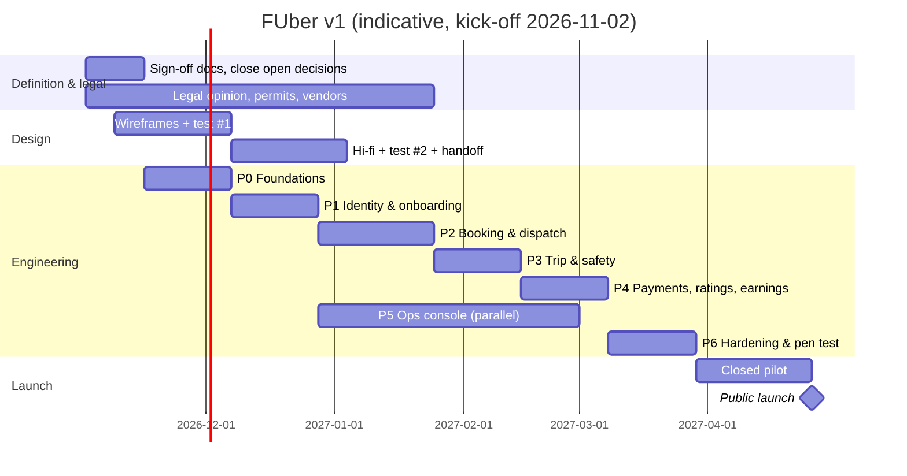

# FUber — Implementation Plan

| | |
| --- | --- |
| Version | 1.0 |
| Date | 2026-10-26 |
| Builds | [PRD](01-product-requirements.md) with the [TRD](02-technical-requirements.md) stack |
| Horizon | ~28 weeks from kick-off to public launch |

---

## 1. Team (minimum viable)

| Role | Count | Notes |
| --- | --- | --- |
| Tech lead / Rust backend | 1 | Owns architecture, security baseline, dispatch |
| Rust backend engineer | 1 | Payments, integrations, worker, ops API |
| Svelte front-end engineers | 2 | One rider app + website, one driver app + ops console; shared `packages/ui` |
| Product designer | 1 | Full-time weeks 1–10, then part-time |
| QA engineer | 1 (from week 8) | E2E automation, device lab |
| DevOps (part-time / contractor) | 0.5 | Terraform, CI/CD, monitoring |
| Product owner | 1 (founder) | Decisions, acceptance, legal & ops coordination |
| Ops lead | 1 (from week 16) | Verification and safety desk processes, pilot driver recruitment |

With fewer people, stretch the timeline rather than cutting Phase 5 (hardening).

## 2. Timeline

## 3. Phases

Each phase ends with a demo on staging and its exit criteria checked. Stories reference PRD IDs.

### Phase 0 — Foundations (3 weeks)

- Monorepo per TRD §3; Cargo workspace (`api`, `worker`, `domain`, `db`, `geo`, `integrations`, `common`); npm workspaces for Svelte apps and packages.
- Local dev: `docker-compose` with PostGIS, Redis, OSRM (Namibia extract) in `infra/docker-compose.yml`; local uploads stay on disk; the cloud uses Cloud Storage; seed data matching the demo (four drivers, one rider, Windhoek places).
- CI: fmt, clippy (`-D warnings`), tests, `svelte-check`, ESLint, `cargo audit`/`deny`, `npm audit`, **gitleaks**, container scan, OpenAPI diff.
- Environments: staging on Terraform; secret manager wired; deploy on merge.
- **Security baseline (built first, not last):**
  - Redis sliding-window rate-limit layer with per-route config (TRD §7.1) + tests.
  - Validation newtypes and `deny_unknown_fields` pattern (TRD §7.2) + an example endpoint with failure tests.
  - Secret loading from the secret manager; `.env.example`; startup fails if a secret is missing.
  - Security headers, CORS allow-list, body-size limits, request timeouts, structured logging with redaction.
- Observability: tracing → OTLP, error tracking, uptime checks.
- Svelte: SvelteKit skeletons for rider/driver (Capacitor iOS + Android projects building in CI), ops, web; `packages/ui` with tokens from the design brief; generated `api-client`.
- Port `domain` logic from `demo/public/js/engine.js`: pricing, matching score, priority points, state machine — with property tests comparing to the demo engine run under Node.

**Exit:** a "hello" endpoint deployed to staging behind rate limiting; both mobile shells install on a real Android and iPhone; security baseline checklist items 1–8 (§6) pass.

**Status (2026-10-29):** staging on Google Cloud written on branch `phase-0/staging`, not yet applied. Distroless, non-root images for the API, worker and a new `migrate` binary (`backend/Dockerfile`); an OSRM image with the Namibia data (`infra/osrm/Dockerfile`, rebuilt monthly by `osrm-image.yml`). Terraform in `infra/terraform/` for `africa-south1`: VPC with private services access and Cloud NAT; Cloud SQL PostgreSQL 16 (private IP, TLS); Memorystore Redis 7 (TLS + AUTH; the API now trusts Memorystore's CA through `REDIS_CA_CERT`); a CMEK-encrypted documents bucket; Artifact Registry; Secret Manager secrets without values; separate service accounts for API, worker, migrations and the internal VM; Cloud Run API service, worker pool and migration job; ClamAV and OSRM on one internal VM; Workload Identity Federation for GitHub. CI's new `deploy-staging` job builds, migrates and deploys on every push to `main` once the repository variables are set. Still open: running the setup in `infra/terraform/README.md`, uploads on staging (need the Cloud Storage backend, Phase 1 vendors), a load balancer with Cloud Armor before production, and monitoring and alerts.

### Phase 1 — Identity & onboarding (3 weeks)

- OTP sign-in (A-1) with SMS provider + fake; sessions, refresh rotation, secure storage on device (TRD §7.4).
- Rider profile, ID + selfie upload pipeline (pre-signed upload, magic-byte check, re-encode, EXIF strip, virus scan) (A-2).
- Emergency contacts (A-3); consents + legal document versions (A-7); account deletion (A-8).
- Driver application, documents with status and expiry, vehicles, tiers (A-4, A-5, A-6).
- Ops API for verification decisions (consumed by Phase 5 UI).

**Exit:** a new rider and a new driver can onboard on real phones; verification decided via API; wrong-user access tests pass for every endpoint.

**Status (2026-10-27):** built on branch `phase-1/identity`. API, worker and both app flows are done; integration tests cover rider and driver onboarding through ops approval, uploads through the worker, deletion and erasure, and wrong-user/unauthenticated/validation checks for every Phase 1 endpoint. Still open: real-phone run, real SMS (blocked on the vendor decision, PRD §10), the Cloud Storage backend, the Driver Agreement text, and CAPTCHA on OTP requests.

### Phase 2 — Booking & dispatch (4 weeks)

- Places search (OSM-derived landmarks, suburbs, streets; accent-insensitive) (B-2).
- OSRM integration; signed quotes with locked price (B-3, P-1); surge zones.
- Ride creation with options: passengers, wheelchair, someone else, schedule (B-4 – B-6).
- Driver online/offline, location over WebSocket, Redis GEO (D-1).
- Matching worker: score, sequential 15 s offers, re-ranking, priority points, concurrency safety (D-2 – D-5).
- WebSocket fan-out via Redis pub/sub; reconnect and state restore.
- Rider and driver UI for booking → offer → assignment.

**Exit:** two people on two phones complete request → offer → accept; race test (20 drivers accepting the same ride) yields exactly one winner; load test 500 simulated drivers passes TRD §6.

**Status (2026-10-28):** built on branch `phase-2/booking-dispatch`. Places search, OSRM routing (straight-line estimate locally), signed locked quotes with surge, ride creation with every option, driver presence, the matching worker with sequential 15 s offers, WebSocket live updates with reconnect, and the rider booking and driver offer screens are done. Presence and fan-out use Postgres instead of Redis (TRD §1). Integration tests cover search, quotes, matching order, privacy in every state, expiry and retry, cancellations, scheduling, guest SMS and the live socket. Merged to `main` on 2026-10-29: the 20-driver race test and the 500-driver load test (`cargo test -p fuber-api --test dispatch -- --ignored`) pass; the load test's own setup was fixed so its drivers actually go online (50 of 50 rides offered, matching tick 1.45 s in a debug build). Still open: the two-phone run on real devices. Locally, sign-in skips the SMS code: the API returns it only when `APP_ENV=local`.

### Phase 3 — Trip & safety (3 weeks)

- En-route tracking, fuzzy pickup, 50 m exact-address reveal, PIN entry with 5-attempt lockout, destination reveal after PIN (T-1 – T-3) — with tests proving the destination is absent from every driver payload before `PIN_VERIFIED`.
- Start/complete trip, wait timer and no-show, cancellations with priority points (T-4 – T-7).
- Chat + masked calling (T-8).
- SOS end-to-end, Share trip page on the website, RideCheck detection in the worker (S-1 – S-3).
- Report an issue (S-5).

**Exit:** full ride on staging with real devices; SOS reaches the (API-level) incident queue and emergency-contact SMS in < 5 s; RideCheck fires in a scripted drive.

**Status (2026-11-02):** in progress on branch `phase-3/trip-safety`. Done (backend, T-2 – T-7): arrival within 50 m (marked by location updates or `POST /rides/{id}/arrive`), PIN entry with 5-attempt lockout to `BLOCKED` plus a `pin_lockout` incident, the 5-minute free wait and rider no-show, start, complete (+2 priority each), driver cancel with a reason back to the pool without her, the rider following the car until drop-off, and the trip GPS track (10 s samples). Integration tests in `crates/api/tests/trip.rs` cover the full trip, lockout, no-show, driver cancel and wrong-user access on every trip endpoint. Cancelling always costs priority points, also for a rider before assignment (decided 2026-11-02; App Flow §7 said no cost). After a PIN lockout the driver gets no requests for 15 minutes (until ops reviews, after 3 lockouts in 7 days) and loses no points (decided 2026-11-03, App Flow §7). Still open: the driver and rider trip screens, chat and masked calling (T-8), SOS, Share trip, RideCheck (S-1 – S-3) and Report an issue (S-5).

### Phase 4 — Payments, ratings, earnings (3 weeks)

- Payment provider integration: tokenised card, pre-auth, capture, void, refund, signed webhooks (P-2 – P-4).
- Cash confirmation; driver ledger; weekly settlement and payouts (P-5, P-6).
- Ratings, favourites, trip history, receipts (R-1 – R-3).
- Notifications matrix (App Flow §10) with SMS fallback.

**Exit:** card and cash rides reconcile to the cent between `rides`, `payments` and `driver_ledger`; refund flow works from ops API.

**Status (2026-11-02):** first slice on branch `phase-4/payments-ratings` (from `phase-3/trip-safety`). Done: completed trips open a pending payment; the driver confirms cash (`POST /rides/{id}/cash-received`), which books FUber's service fee against her in `driver_ledger` (P-2, P-5); the earnings dashboard for today or the week with hours online and the balance (P-6); two-way ratings with reasons below 3 stars, running averages, the driver's skip and rider favourites, ending in `RATED` (R-1); trip history for riders and drivers that follows the same privacy rules as the live views (R-2); and the matching screens in both apps (cash received, rating, fare breakdown, earnings and trips, your trips). Integration tests in `crates/api/tests/after_trip.rs`. Still open: card payments, refunds and webhooks (P-3, P-4; blocked on the payment provider, PRD §10 decision 6), weekly settlement and payouts, receipts by email, the lost-item flow (R-3) and the notifications matrix with push and SMS fallback.

### Phase 5 — Ops console (9 weeks, in parallel from Phase 2)

- Staff auth with argon2 + mandatory TOTP/WebAuthn; roles; audit log (O-7).
- Verification queues and review screens with audited image access (O-1).
- Users, suspensions, priority adjustments (O-2, O-6).
- Live map; incidents console with audible alerts, claim, escalate, close (O-3, O-4).
- Pricing, surge zones, matching settings (O-5, D-6).
- Reports (O-8).

**Exit:** a safety agent handles a scripted SOS end-to-end within 60 s; every ops action appears in the audit log.

**Status (2026-11-02):** a first review page (O-1) is in `apps/ops` on branch `ops/review-page`, ahead of the rest of this phase: staff sign-in (password + authenticator code), the queues of driver applications and rider ID checks, and review screens to approve or reject each document, the car, the ride types and the application, and to verify riders. The staff token is kept in memory only (a reload signs out) until the cookie + CSRF session below. Locally it runs at `http://127.0.0.1:5175` (`npm run dev -w @fuber/ops`); create staff with the `staff` binary.

### Phase 6 — Hardening (3 weeks)

- External **penetration test** (API, mobile apps, ops console); fix all High/Critical.
- OWASP ZAP DAST on staging; MASVS checklist for mobile.
- Load and soak test (24 h); chaos test: kill an API instance mid-ride, Redis failover, SMS provider down.
- Accessibility audit (WCAG 2.2 AA) and fixes.
- Backups restore drill; incident runbooks; on-call rota.
- Final legal texts in app and on website; app-store listings, privacy labels (Apple) and Data safety form (Google).

**Exit:** launch checklist (§6) fully green.

### Pilot (4 weeks) → Public launch

- 30–50 vetted drivers, 300–500 invited riders, Windhoek only; safety desk staffed 24/7.
- Weekly releases; daily metrics review against PRD §3 targets.
- Go / no-go meeting at the end of week 4.

## 4. Definition of done (every story)

- Acceptance criteria met and demoed on staging.
- Unit + integration tests, including validation-failure, rate-limit and wrong-user tests for new endpoints.
- OpenAPI updated; generated client compiles.
- No new `cargo audit`/`npm audit` High findings; gitleaks clean.
- Logs contain no PII beyond the redaction rules.
- UI: light + dark, screen-reader labels, works at 200 % font size.
- Docs updated if behaviour differs from these documents.

## 5. Risks

| Risk | Impact | Mitigation |
| --- | --- | --- |
| Women-only model legally challenged | Launch blocked | Legal opinion in Stage 1 (PRD §10.1) before spending on marketing |
| Driver supply too low at launch | Poor match rate | Recruit & verify drivers from week 12; pilot only in central suburbs; scheduled rides to smooth demand |
| Card acquiring in NAD slow to set up | No card payments at pilot | Pilot with cash; card behind a feature flag |
| SMS delivery unreliable | OTP and SOS fail | Two SMS providers with failover; in-app push first; SOS falls back to device SMS |
| Background location killed by Android OEMs | Drivers vanish from map | Foreground service with notification; OEM-specific guidance screen; heartbeat expiry |
| Small team, Rust learning curve | Slips | Keep a modular monolith; boring dependencies; pair on dispatch |
| Identity fraud | Unsafe rides | Manual review + liveness; duplicate-ID hash; PIN at pickup |

## 6. Launch checklist (security & compliance gate)

Security

1. [ ] Rate limits active on **every** public endpoint and the WebSocket handshake; tests cover each group in TRD §7.1.
2. [ ] All request bodies use typed structs with `deny_unknown_fields` and validated newtypes; validation-failure tests exist per endpoint.
3. [ ] No secrets in repo, images or app bundles (gitleaks + manual bundle inspection); all server secrets in the secret manager.
4. [ ] Client-side keys (maps, payments publishable, FCM) restricted by app ID/domain and quota.
5. [ ] Secret rotation runbook tested once.
6. [ ] Webhooks signature-verified and idempotent.
7. [ ] Security headers, CSP, CORS allow-list, TLS/HSTS verified with an external scanner.
8. [ ] Logging redaction verified (no OTP, token, PIN, full phone, exact address).
9. [ ] Object-level authorisation tests for every endpoint.
10. [ ] Upload pipeline: type check, re-encode, EXIF strip, AV scan.
11. [ ] Ops console: 2FA enforced, roles, audit log, session timeout.
12. [ ] Penetration test: no open High/Critical.
13. [ ] Backups + restore drill done; encryption at rest confirmed.

Legal & policy

14. [ ] Privacy Policy, Terms & Conditions, Driver Agreement and Cookie Policy reviewed by Namibian counsel and published at stable URLs; versions seeded in `legal_documents`.
15. [ ] In-app acceptance and re-acceptance flow working; consents recorded.
16. [ ] Account deletion and data-subject request process documented and tested.
17. [ ] Retention jobs implemented to match the Privacy Policy.
18. [ ] Women-only legal opinion on file; transport permits confirmed.
19. [ ] Data processing agreements signed with SMS, payments, ID-verification, hosting vendors.

Operations

20. [ ] 24/7 safety desk staffed; SOS drill passed.
21. [ ] On-call rota and paging; runbooks reviewed.
22. [ ] App Store / Play listings approved, privacy labels accurate.

## 7. Stakeholder decisions (2026-11-04)

| Topic | Decision | State in the code |
| --- | --- | --- |
| 5 wrong PINs | Driver blocked from new requests until ops clears it | Built (`POST /ops/incidents/{id}/close`, ops Safety desk page) |
| Name | Product renamed to **VARA** (Verified, Authenticated, Reliable, App) | Not started; needs the domain and app IDs |
| Launch promotion | No 32 % promotion, no commission under 15 %. Launch on 15–18 % | Fees already 15 / 16.5 / 18 % (migration 0007); no promotion exists |
| Map Experts | Flat 15 % for drivers working unmapped or newly developed zones who help verify wayfinding and geofencing | Not started; needs qualification thresholds and who grants it |
| Background location | Tauri or native handling approved if it keeps drivers visible | Stay on Capacitor; native foreground service still to build and test on Samsung and Huawei |
| Cards | DPO Pay or PayToday; PayPoint later. Closed pilot on cash only | Provider integration not started; final pick open |
| Masked calls | Explore MTC / Paratus; in-app chat is primary meanwhile | Chat (T-8) not built yet |

**Launch date:** set once Phase 3, cloud staging, real SMS and legal approvals are finished.

## 8. First two weeks — concrete next steps

1. Founders review and sign off these documents; close PRD §10 decisions 6–9 (vendors) and start 1–5 with counsel.
2. Engage a Namibian law firm: women-only opinion, Terms/Privacy review, Driver Agreement, transport permits.
3. Open accounts (sandbox) with the shortlisted payment provider and two SMS providers.
4. Hire / contract the designer; start design brief week 1.
5. Create the new monorepo skeleton (Phase 0) on a branch; move `ride-hailing-backend/` and `rider_app/` to an `archive` branch.
6. Book the penetration-test vendor for Phase 6 dates now (lead times are long).
